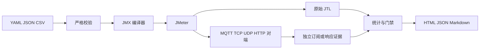

# 架构 消息契约与指标口径

工具以 JMeter 为负载发生器，Python 负责配置、编排、独立校验和报告。生产入口与开发实验入口分开，发行包仅分析并冻结生产入口依赖。



## 模块与生命周期

`config.py` 定义版本化场景；`plans.py` 编排 MQTT，`network_plans.py` 编排 TCP/UDP/HTTP；`runner.py` 启动、采样资源并收尾；`collector.py` 验证消息；`network_receipts.py` 导入 JMeter 保存的响应证据；`metrics.py` 计算分布与门禁；`reporting.py` 输出本地报告。

每次运行获得 16 位随机十六进制 ID，创建独立目录，依次进入 preparing、subscribing（MQTT）、running、draining 和终态。终态可能为 passed、failed、error、timeout、cancelled。异常结束也尽量保留部分采样、采集记录与诊断报告；配置或环境预检失败发生在启动之前。

JMeter 使用独立进程组，超时或取消时终止该组。每 0.5 秒记录 Java 进程 CPU、RSS 与本机资源；不能用这些数据替代远端 Broker 或数据库的监控。进程 CPU 百分比按单核口径，可能超过 100%。

## 消息契约

```json
{
  "schema_version": 1,
  "run_id": "0123456789abcdef",
  "device_id": "dg-00001",
  "device_type": "home",
  "site": "dongguan",
  "seq": 1,
  "message_id": "0123456789abcdef:dg-00001:1",
  "sent_at_ms": 1792044000000,
  "temperature_c": 26.5,
  "padding": ""
}
```

温度须为有限数值且在 -40～125℃ 范围，身份与分类字段须匹配终端清单，序列号在本次预期范围内，消息 ID 必须与运行、终端、序列号一致。重复消息不提高完整率；乱序按单终端接收顺序计算。负时间差或异常时间戳按非法消息处理。

TCP 请求与响应各使用一行 UTF-8 JSON，以 LF 字节 10 结束；UDP 一条数据报对应一条 JSON；HTTP 响应为相同契约的 JSON。对端应保留身份和发送时间戳，自定义响应格式需适配解析器。

## MQTT 时序与采集阶段

独立采集器先收到 SUBACK。JMeter 原生 SubSampler 安装监听器后，再通过连接接口确认订阅完成并释放终端线程，避免固定等待造成订阅竞态。终端随后连接、逐条发布并断开。订阅探针使用有界时间窗口，避免插件按消息数等待时无超时的问题。

上行 Topic 为 `<prefix>/<run_id>/up/<device_id>`。参考采集服务 `pipeline.py` 在 SQLite 事务提交后，向 `persisted` 阶段发送同一消息的回执。独立校验器可订阅该阶段，从而把落库操作纳入验证路径。该参考服务不实现持久化 Outbox 和高可用恢复，不应当作生产采集平台。

## 指标公式

| 指标 | 定义 |
| --- | --- |
| 预期消息数 | 终端数 × 每终端消息数 |
| 完整率 | 有效唯一消息数 / 预期消息数 × 100% |
| 缺失 | max(0, 预期消息数 - 有效唯一消息数)，包含未发出、非法、丢弃与未到达的消息 |
| 错误率 | JTL 失败采样行数 / JTL 采样行数 × 100%，排除节拍与零消息探针行 |
| 业务吞吐量 | 业务采样行数 / 整个 JMeter 采样区间秒数，包含 Ramp-up 与收尾，不是纯稳态峰值 |
| P50/P95/P99 | 基于毫秒直方图的 nearest-rank 分位数 |
| 峰值活跃终端数 | 业务采样 JTL 中 `grpThreads` 的最大值，MQTT 订阅探针所在组不计入 |
| MQTT 采集延迟 | 采集处理完成时间 - 终端发送时间戳 |
| TCP/UDP/HTTP 往返延迟 | 客户端收到响应时间 - 请求发送时间戳，包含服务端处理 |

发送时间戳在节拍等待结束后生成。MQTT 发布耗时是插件操作时间；QoS 0 不等待 PUBACK。插件订阅批次的零耗时或窗口耗时不能充当端到端消息延迟。

TCP/UDP/HTTP 响应证据在 Java 端接收时立即记录时间，再由 Python 导入；不能用 Python 导入时间计算往返耗时。UDP 会记录匹配前收到的旧响应，并在结束时短暂排空尾部响应，用于识别重复和乱序。超出接收窗口的响应仍可能记为缺失。

## 结果与可重复性

场景、终端 CSV 与 JMX 的摘要保存在 provenance 中。重复试验保持负载、消息大小、随机种子、目标服务、QoS、采集阶段和硬件一致。随机运行 ID 与发送时间戳每次不同，负载内容的数值序列可由种子重现。

HTML 报告不访问外部 CDN，动态文本转义后呈现。结果目录按运行 ID 隔离；保存期限和备份由使用方按项目要求安排。
