# JMeter 四协议终端模拟与采集链路实验技术报告

中国联通广东产互东莞中试验证中心项目

报告版本 1.0　软件版本 1.0.1　实验日期 2026年10月15日

适用对象为项目研发、实施、测试与技术评审人员。本报告记录 MQTT、TCP、UDP、HTTP 的终端模拟、数据交付校验和链路测量方法，给出实际执行截图、原始数据定位及复现步骤。

## 摘要

本次在同一台 Mac 上重新执行了 33 项真实 JMeter 实验，全部符合预期。其中 14 项正向场景通过业务验收，19 项故障场景触发预期业务失败及指定异常信号。四协议的 50 终端场景均交付 1000 条有效唯一消息，JTL 记录的实际活跃终端峰值均为 50。随后执行的 34 项自动化测试全部通过，MQTT 上报至 SQLite 提交后回执的参考链路也完成了 50 条消息验证。

这些结果支持本工具的协议编排、消息关联、数据完整性和异常门禁按当前契约工作。实验采用同机回环服务和合成遥测消息，不能据此宣称现场吞吐极限、跨网时延或整个平台长期稳定性已经验收。

| 协议 | 实验数 | 符合预期 | 50 终端有效交付 |
| --- | --- | --- | --- |
| MQTT | 5 | 5 | 1000 / 1000 |
| TCP | 8 | 8 | 1000 / 1000 |
| UDP | 9 | 9 | 1000 / 1000 |
| HTTP | 11 | 11 | 1000 / 1000 |

报告阅读顺序为实验环境与统一方法、四协议过程与结果、异常检出、完整实验矩阵、采集落库链路、跨平台验证及证据索引。所有截图均为浏览器实际页面截图，仅裁去无关浏览器界面与空白，未改写页面数据。

## 1 实验环境与取证方式

负载发生器、独立采集器及本地参考服务均运行在本机。处理器为 Apple M6，逻辑 CPU 12 个，内存 24.0 GiB，架构 arm64。系统上报版本为 macOS-27.0.1-arm64-arm-64bit-Mach-O，Python 3.14.8，JMeter 5.6.3，EMQX mqtt-xmeter 插件 2.0.2。Java 的实际版本字符串保留在 doctor.json 中。

首次执行 doctor 检查 Java 主版本、JMeter 清单版本和 MQTT 插件摘要，三项均通过。实验服务只监听 127.0.0.1，端口由参考服务动态分配，因此截图中的端口是本次实际端口，复测时可能变化。

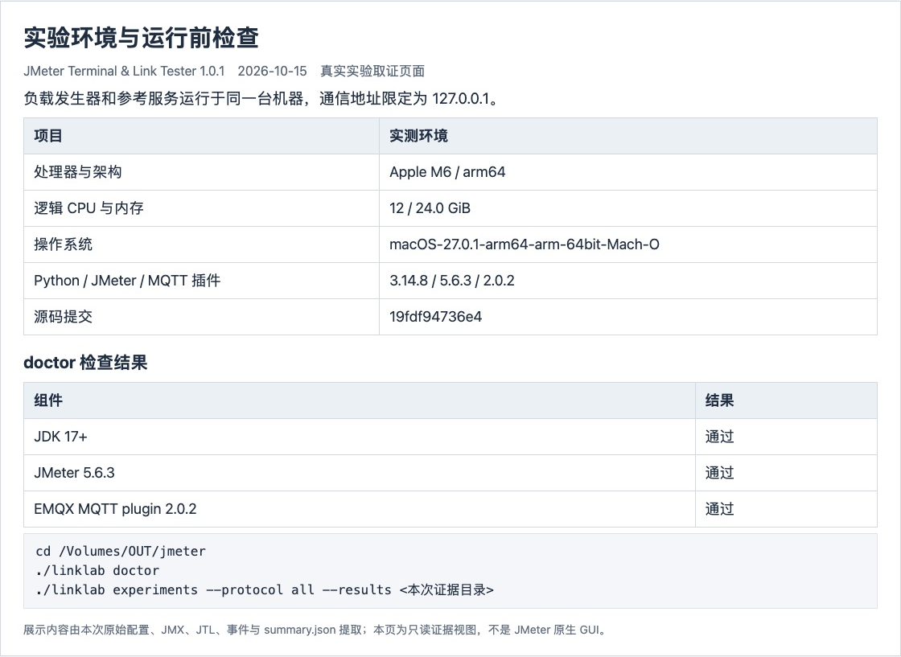
图1 实验环境与运行前检查的实际页面截图

本次实验所用源码提交为 19fdf94736e4f6b13324bf2396c5c78a42d57eb9。截图采用只读证据页面显示实际 scenario.json、JMX、events.jsonl、JTL 汇总与门禁结果；这些页面不是 JMeter 原生图形界面。原始 JMeter HTML 报告和 dashboard 仍随每次运行保留。

## 2 实验设计与统一评价方法

一条 JMeter 线程表示一个逻辑终端。基线使用 5 个终端、每终端 10 条消息；并发场景使用 50 个终端、每终端 20 条消息。两类场景均以 1 秒 Ramp-up 启动，业务请求前等待 100 ms，再生成实际发送时间戳。终端数是配置量，是否达到预期并发还需从业务采样的 grpThreads 观测值核对。

| 场景 | 终端数 | 每终端消息 | 预期消息 | Ramp-up | 间隔 |
| --- | --- | --- | --- | --- | --- |
| 基线 | 5 | 10 | 50 | 1 s | 100 ms |
| 并发 | 50 | 20 | 1000 | 1 s | 100 ms |
| 多数响应故障 | 2 | 6 | 12 | 0 s | 10 ms |

执行器先校验配置和 CSV，再生成 JMX、启动独立采集或接收响应记录，运行真实 Java JMeter 进程，最后排空采集并执行门禁。每次运行使用独立 run_id、终端 ID 与消息 ID，避免把历史消息或重复消息计入交付。

有效唯一完整率等于有效唯一消息数除以预期消息数乘 100%。业务采样错误率等于该业务标签错误数除以采样数乘 100%。P50、P95、P99 采用 nearest-rank 顺序统计，JMeter elapsed 以毫秒记录；显示为 0 ms 的采样只说明落在毫秒量化范围内。

业务消息吞吐量等于业务采样数除以整个 JMeter 采样区间；它包含连接、Ramp-up 和收尾。MQTT 的 Publish 耗时与独立采集处理延迟分别统计；TCP、UDP、HTTP 的响应观测延迟包含服务端处理，不能解释成单向网络延迟。不同协议的生命周期和观测语义不同，本报告不据此给协议排序。

默认门禁要求业务采样数等于预期消息数、错误率为 0、有效唯一完整率为 100%、业务请求 P95 和采集或响应 P95 均不高于 3000 ms，非法、重复、乱序、队列溢出为 0。MQTT 另校验连接和断开数量以及观察订阅就绪和消息数。故障实验有意违反其中一项或多项要求，并额外核对指定故障信号。

```text
macOS
./linklab experiments --protocol all --results <本次证据目录>/runs

Windows PowerShell
.\linklab.cmd experiments --protocol all --results <本次证据目录>\runs
```

本轮矩阵串行执行，未同时运行其他压测任务。浏览器用于读取已完成的实验文件；业务采样区间和本机资源记录见每次运行的 samples.jtl 与 resources.csv。

## 3 四协议整体实验结果

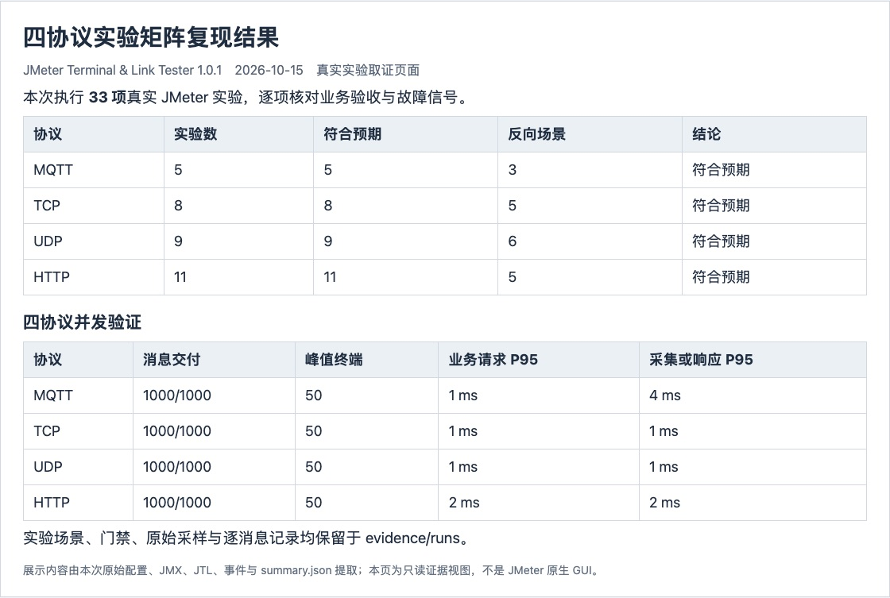
图2 本次完整实验矩阵与四协议并发交付汇总

33 项实验全部揭示了预期行为。正向场景的“通过”与反向场景的“未通过”分别按其预先定义的期望核对，因此不能把 33 项符合预期误写成 33 项业务验收均通过。下表只比较同一 50 终端负载下的观测值。

| 协议 | 请求均值 ms | 请求 P95 ms | 请求 P99 ms | 采集或响应 P95 ms | 业务条数每秒 |
| --- | --- | --- | --- | --- | --- |
| MQTT | 0.37 | 1 | 1 | 4 | 161.42 |
| TCP | 0.32 | 1 | 7 | 1 | 378.79 |
| UDP | 2.28 | 1 | 90 | 1 | 383.58 |
| HTTP | 0.97 | 2 | 20 | 2 | 390.47 |

四场景的业务采样错误率均为 0，缺失、非法、重复和乱序计数均为 0。UDP 的请求 P99 为 90 ms，明显高于其 P95 的 1 ms；这提示尾部延迟需要在更长的独立负载实验中关注。当前短时回环数据不足以把差异归因到某一个操作系统、GC 或网络因素。

## 4 MQTT 终端上报与独立采集实验

MQTT 使用 EMQX 插件的 Connect、Publish、Subscribe、Disconnect 原生采样器，默认 MQTT 3.1.1、QoS 1。发布主题包含 topic_prefix、run_id 和 device_id。独立 Paho 采集器在收到 SUBACK 后就绪；JMeter 观察订阅也建立就绪屏障，发布端随后才发送消息。

CSV 参数进入连接与发布流程，订阅端核对消息身份、序列、时间戳及遥测字段。Publish 的成功只证明该采样器成功完成，最终交付必须以独立采集到的有效唯一消息为准。

```text
./linklab demo --protocol mqtt
./linklab plan scenarios/baseline.yaml --output build/mqtt-debug
./linklab gui build/mqtt-debug/test-plan.jmx
```

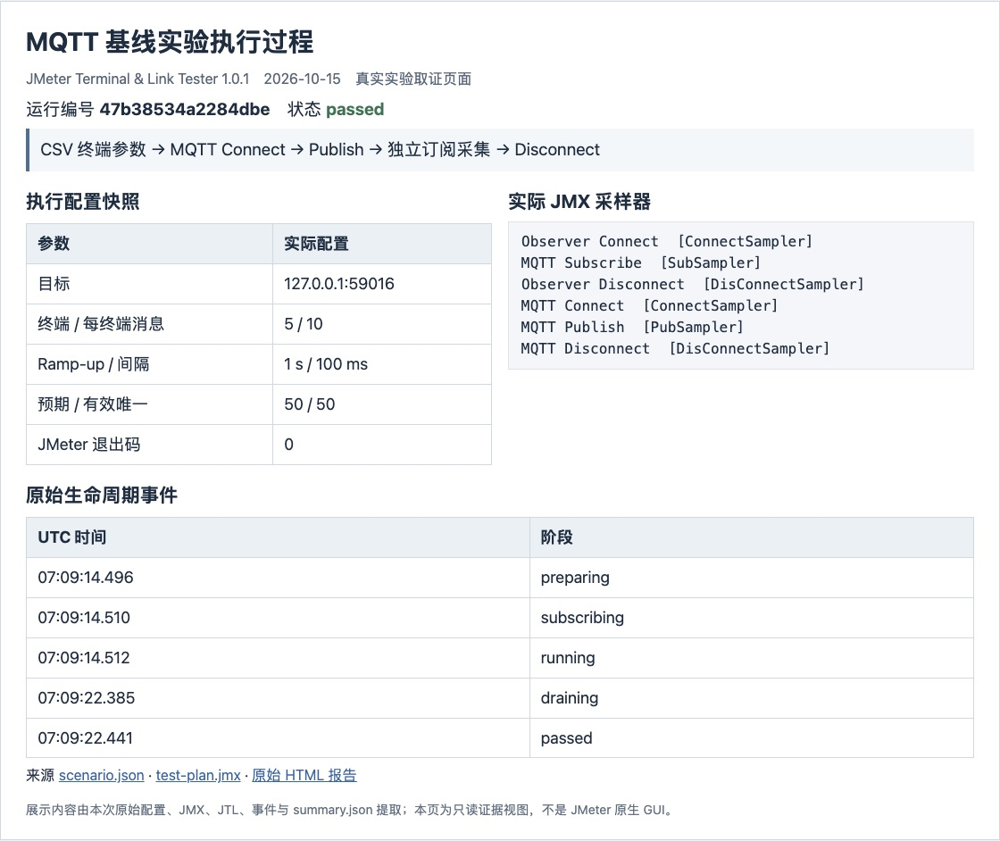
图3 MQTT 基线运行配置 编排与生命周期事件的实际截图

基线运行编号为 47b38534a2284dbe。实际业务采样 50 条，有效唯一消息 50 条，业务错误率 0.00%，完整率 100.00%。JMeter 退出码为 0，业务验收通过。

## 4 MQTT 并发结果与指标解释

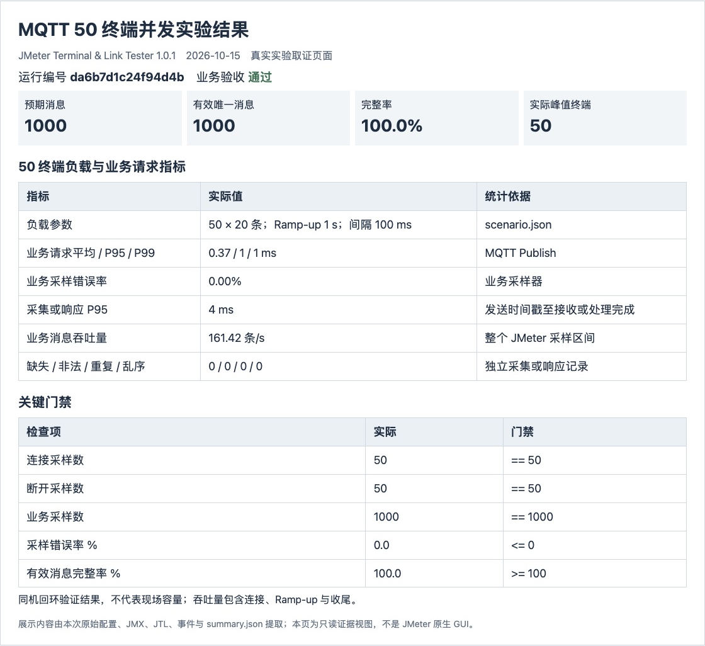
图4 MQTT 50 终端并发实验的实际结果截图

| 负载 | 请求均值 ms | P95 ms | P99 ms | 完整率 | 吞吐 条每秒 |
| --- | --- | --- | --- | --- | --- |
| 5 终端 | 0.76 | 2 | 2 | 100% | 10.09 |
| 50 终端 | 0.37 | 1 | 1 | 100% | 161.42 |

并发运行编号为 da6b7d1c24f94d4b。实际活跃峰值为 50，有效唯一交付 1000 / 1000 条，采集或响应 P95 为 4 ms。统计使用本次 JTL 的真实采样区间，不能将表中吞吐量当成协议或现场服务的极限吞吐量。

MQTT 的连接、观察订阅和断开也占用整体采样区间，因此业务条数每秒与 TCP、UDP、HTTP 的区间定义存在生命周期差异。QoS 0 不等待 PUBACK，QoS 2 的握手语义又不同；三种 QoS 不能仅用 Publish 采样耗时混为一种链路时延。

## 4 MQTT 故障注入与检出依据

每第 3 条消息注入非法负载。检测到的非法消息不能进入有效唯一计数，完整率因此下降；同时必须看到预期非法信号，不能仅凭任意非零退出码认定实验成功。

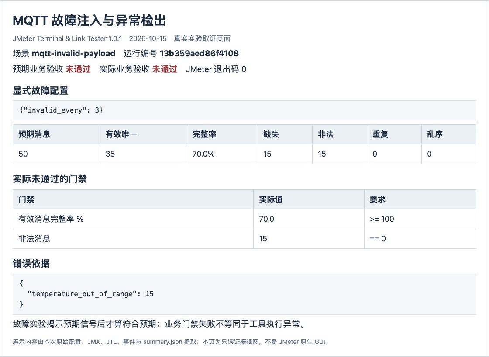
图5 MQTT 故障配置 异常计数与未通过门禁的实际截图

本例运行编号为 13b359aed86f4108。预期业务验收和实际业务验收均为未通过；矩阵还核对了指定异常信号，因此本项实验符合预期。JMeter 正常退出与业务门禁通过是两个独立条件，日志显示的 failed 不等于实验框架执行失败。

另覆盖采集丢弃与处理延迟。MQTT QoS 0 和 2 由启用集成开关的自动化测试验证。

## 5 TCP 连接复用与分帧实验

TCP 使用 JMeter 原生 TCPSampler 和 TCPClientImpl，以 UTF-8 JSON 加 LF 字节作为消息边界，每个逻辑终端复用自己的连接。连接超时和响应超时均有显式配置，返回内容必须保留 message_id 与约定字段。

执行过程先生成终端参数和请求数据，再由原生 TCP 采样器完成收发，后处理器校验响应 JSON 和消息 ID，最后导入逐线程响应记录进行统一完整性检查。应用接入其他二进制帧时，需要替换分帧或协议适配器。

```text
./linklab demo --protocol tcp
./linklab plan scenarios/tcp-baseline.yaml --output build/tcp-debug
./linklab gui build/tcp-debug/test-plan.jmx
```

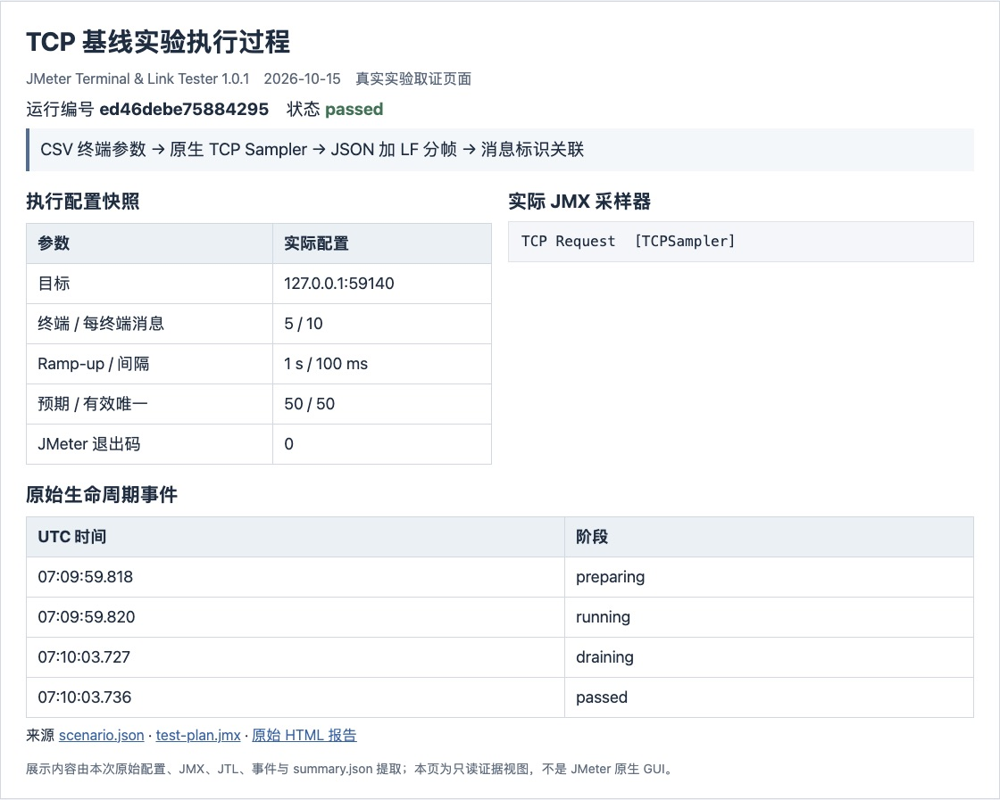
图6 TCP 基线运行配置 编排与生命周期事件的实际截图

基线运行编号为 ed46debe75884295。实际业务采样 50 条，有效唯一消息 50 条，业务错误率 0.00%，完整率 100.00%。JMeter 退出码为 0，业务验收通过。

## 5 TCP 并发结果与指标解释

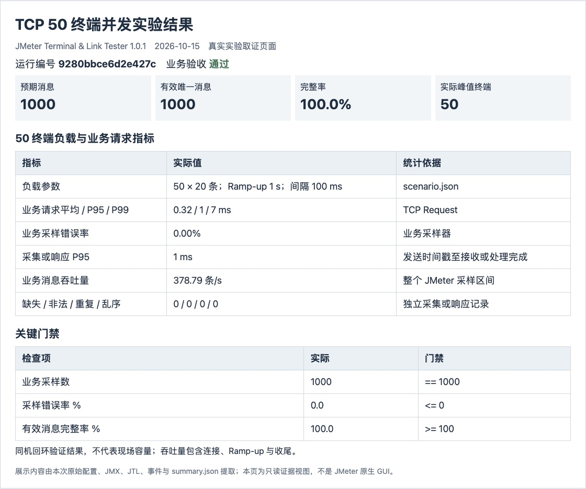
图7 TCP 50 终端并发实验的实际结果截图

| 负载 | 请求均值 ms | P95 ms | P99 ms | 完整率 | 吞吐 条每秒 |
| --- | --- | --- | --- | --- | --- |
| 5 终端 | 0.58 | 1 | 6 | 100% | 34.39 |
| 50 终端 | 0.32 | 1 | 7 | 100% | 378.79 |

并发运行编号为 9280bbce6d2e427c。实际活跃峰值为 50，有效唯一交付 1000 / 1000 条，采集或响应 P95 为 1 ms。统计使用本次 JTL 的真实采样区间，不能将表中吞吐量当成协议或现场服务的极限吞吐量。

## 5 TCP 故障注入与检出依据

参考服务按 response_drop_every 等于 2 丢弃响应。服务端可能已经收到请求，但客户端没有取得有效关联响应，因此该口径下计为缺失。实验不把它直接解释为服务端未落库。

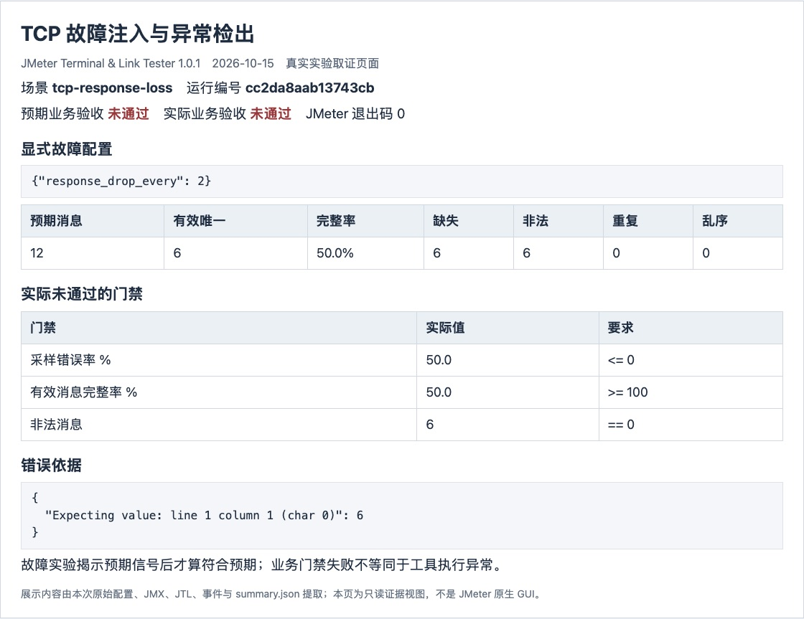
图8 TCP 故障配置 异常计数与未通过门禁的实际截图

本例运行编号为 cc2da8aab13743cb。预期业务验收和实际业务验收均为未通过；矩阵还核对了指定异常信号，因此本项实验符合预期。JMeter 正常退出与业务门禁通过是两个独立条件，日志显示的 failed 不等于实验框架执行失败。

另覆盖非法响应、错误消息 ID、处理延迟、每次 7 字节分段与突然断连。分段场景应通过，突然断连场景必须检出消息缺失。

## 6 UDP 数据报关联与质量实验

UDP 使用 JSR223 Groovy DatagramSocket 采样器，套接字限定对端，按 message_id 匹配响应，并在剩余时间预算内接收。每个 JSON 对应一个数据报；重复、迟到或其他消息的数据报会被记录，而不会被误当成当前请求成功。

循环结束后执行有界收尾接收，保留迟到和重复记录。完整率只按有效唯一消息计算；即使完整率达到 100%，重复或乱序仍可能使质量门禁失败，因此需要同时核对多个维度。

```text
./linklab demo --protocol udp
./linklab plan scenarios/udp-baseline.yaml --output build/udp-debug
./linklab gui build/udp-debug/test-plan.jmx
```

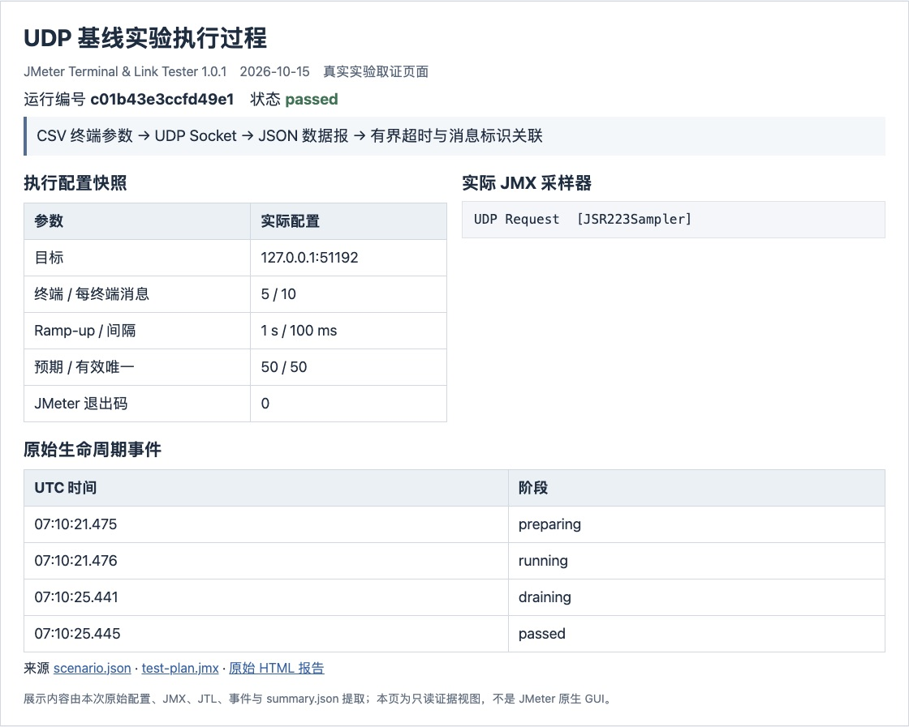
图9 UDP 基线运行配置 编排与生命周期事件的实际截图

基线运行编号为 c01b43e3ccfd49e1。实际业务采样 50 条，有效唯一消息 50 条，业务错误率 0.00%，完整率 100.00%。JMeter 退出码为 0，业务验收通过。

## 6 UDP 并发结果与指标解释


图10 UDP 50 终端并发实验的实际结果截图

| 负载 | 请求均值 ms | P95 ms | P99 ms | 完整率 | 吞吐 条每秒 |
| --- | --- | --- | --- | --- | --- |
| 5 终端 | 4.46 | 16 | 81 | 100% | 35.41 |
| 50 终端 | 2.28 | 1 | 90 | 100% | 383.58 |

并发运行编号为 8c52eadc836143a9。实际活跃峰值为 50，有效唯一交付 1000 / 1000 条，采集或响应 P95 为 1 ms。统计使用本次 JTL 的真实采样区间，不能将表中吞吐量当成协议或现场服务的极限吞吐量。

本次 UDP 请求 P99 达到 90 ms，而 P95 为 1 ms。基线 P95 为 16 ms，也不能据此断言并发提升会降低延迟。短时测试的预热、脚本执行与调度均可能影响尾部，应固定更长的稳态窗口和重复次数后评估。

## 6 UDP 故障注入与检出依据

参考服务按 udp_duplicate_every 等于 2 真实发送重复数据报。重复消息不增加有效唯一数，但应增加 duplicates 计数，触发重复消息门禁；这是一项完整率不能单独检出的质量异常。

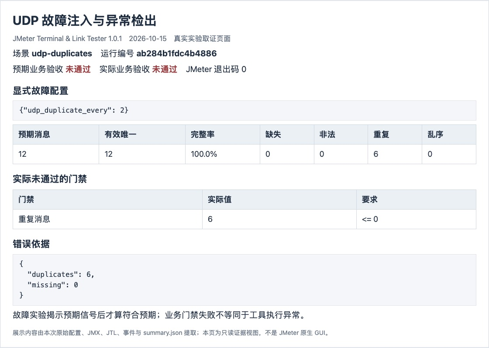
图11 UDP 故障配置 异常计数与未通过门禁的实际截图

本例运行编号为 ab284b1fdc4b4886。预期业务验收和实际业务验收均为未通过；矩阵还核对了指定异常信号，因此本项实验符合预期。JMeter 正常退出与业务门禁通过是两个独立条件，日志显示的 failed 不等于实验框架执行失败。

另覆盖非法响应、错误消息 ID、响应丢失、处理延迟、成对乱序和 4096 字节填充负载。乱序场景核对 out_of_order，不能靠完整率代替。

## 7 HTTP 请求断言与内容实验

HTTP 使用 JMeter 原生 HTTPSamplerProxy。基线和并发采用 POST JSON，状态码按 expected_status 校验，响应后处理器再校验 JSON 与 message_id。GET 把 JSON 放入 URL 编码的 payload 参数；PUT、PATCH、DELETE 使用 JSON 请求体。

可通过 http.bearer_token_env 指定 Bearer Token 的环境变量名；认证值不写入场景文件或生成的 JMX。本轮回环实验未启用认证，不据此宣称已验证现场鉴权接口。HTTPS 和 TLS 不属于当前封装范围。

```text
./linklab demo --protocol http
./linklab plan scenarios/http-baseline.yaml --output build/http-debug
./linklab gui build/http-debug/test-plan.jmx
```

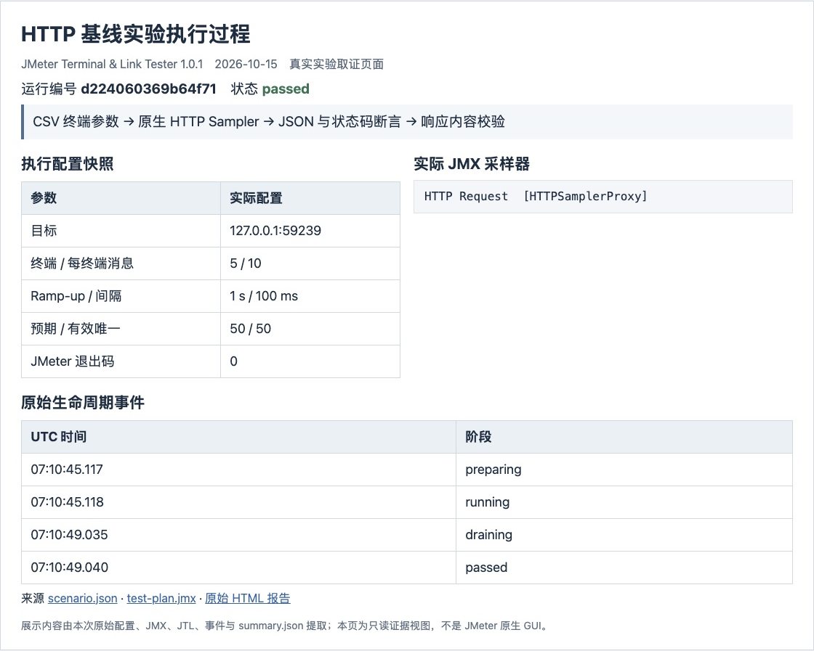
图12 HTTP 基线运行配置 编排与生命周期事件的实际截图

基线运行编号为 d224060369b64f71。实际业务采样 50 条，有效唯一消息 50 条，业务错误率 0.00%，完整率 100.00%。JMeter 退出码为 0，业务验收通过。

## 7 HTTP 并发结果与指标解释

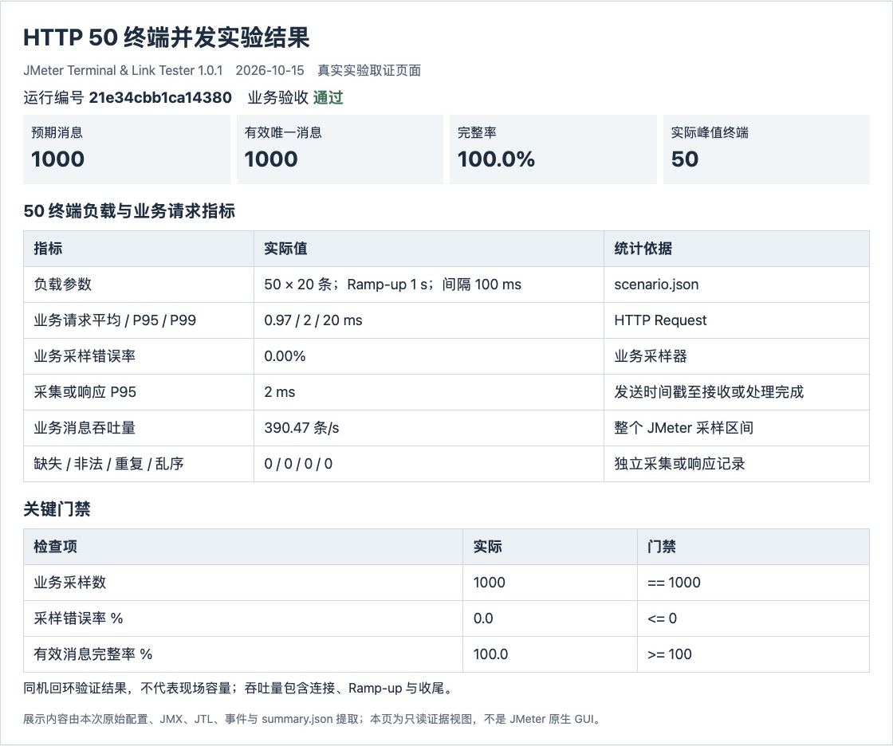
图13 HTTP 50 终端并发实验的实际结果截图

| 负载 | 请求均值 ms | P95 ms | P99 ms | 完整率 | 吞吐 条每秒 |
| --- | --- | --- | --- | --- | --- |
| 5 终端 | 1.88 | 3 | 15 | 100% | 35.19 |
| 50 终端 | 0.97 | 2 | 20 | 100% | 390.47 |

并发运行编号为 21e34cbb1ca14380。实际活跃峰值为 50，有效唯一交付 1000 / 1000 条，采集或响应 P95 为 2 ms。统计使用本次 JTL 的真实采样区间，不能将表中吞吐量当成协议或现场服务的极限吞吐量。

## 7 HTTP 故障注入与检出依据

参考服务每第 2 个序列返回 HTTP 错误状态。JMeter 状态码断言、采样错误率与独立内容校验共同阻止错误响应被计为成功交付。HTTP 状态码正确也仍需检查业务消息身份。

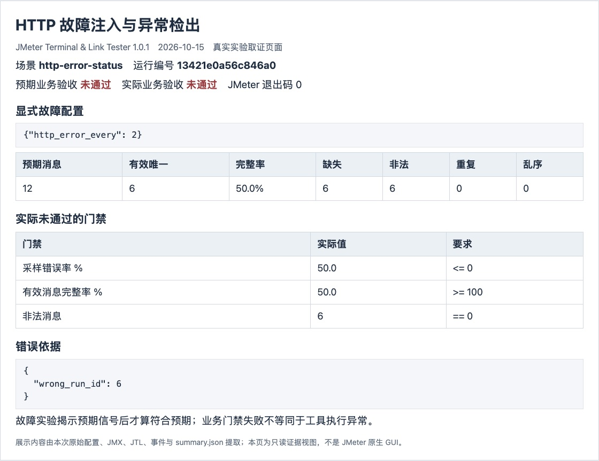
图14 HTTP 故障配置 异常计数与未通过门禁的实际截图

本例运行编号为 13421e0a56c846a0。预期业务验收和实际业务验收均为未通过；矩阵还核对了指定异常信号，因此本项实验符合预期。JMeter 正常退出与业务门禁通过是两个独立条件，日志显示的 failed 不等于实验框架执行失败。

另覆盖 GET、PUT、PATCH、DELETE，以及非法响应、错误消息 ID、响应丢失和处理延迟。POST 由基线和并发场景覆盖，五种方法均有真实请求验证。

## 8 MQTT 与 TCP 完整实验矩阵

下表为本次实际运行结果。正向场景要求业务通过；反向场景要求业务失败并观察到预设信号。全部场景均已核对预期与实际结论，具体运行目录见 experiment-matrix.json。

| 场景 | 业务结论 | 完整率 | 核对依据 |
| --- | --- | --- | --- |
| mqtt-baseline | 通过 | 100.0% | 正向门禁全部通过 |
| mqtt-concurrent-50 | 通过 | 100.0% | 峰值活跃终端 ≥ 50 |
| mqtt-invalid-payload | 未通过 | 70.0% | 非法 ≥ 15 |
| mqtt-collection-drop | 未通过 | 80.0% | 注入丢弃 ≥ 10 |
| mqtt-processing-delay | 未通过 | 100.0% | 采集或响应 P95 ms ≥ 41 |
| tcp-baseline | 通过 | 100.0% | 正向门禁全部通过 |
| tcp-concurrent-50 | 通过 | 100.0% | 峰值活跃终端 ≥ 50 |
| tcp-invalid-response | 未通过 | 50.0% | 非法 ≥ 6 |
| tcp-wrong-message-id | 未通过 | 50.0% | 非法 ≥ 6 |
| tcp-response-loss | 未通过 | 50.0% | 缺失 ≥ 6 |
| tcp-processing-delay | 未通过 | 100.0% | 采集或响应 P95 ms ≥ 41 |
| tcp-fragmented | 通过 | 100.0% | 正向门禁全部通过 |
| tcp-abrupt-close | 未通过 | 33.3% | 缺失 ≥ 6 |

### 单项实验的判定流程

先确认 Java JMeter 进程正常启动并退出，再确认业务标签的采样数等于预期数量，随后检查独立采集或响应数据的身份与完整率，最后核对质量计数和分位门禁。故障注入时还需比较预先指定的检测信号，防止把启动失败或无采样误认为预期异常。

例如采集丢弃场景需观察 injected_drops，TCP 断连场景需观察 missing；即使两者都降低完整率，也不能互相替代解释。TCP 分段属于正常传输行为，应完整重组并通过业务验收。

## 8 UDP 与 HTTP 完整实验矩阵

下表为本次实际运行结果。正向场景要求业务通过；反向场景要求业务失败并观察到预设信号。全部场景均已核对预期与实际结论，具体运行目录见 experiment-matrix.json。

| 场景 | 业务结论 | 完整率 | 核对依据 |
| --- | --- | --- | --- |
| udp-baseline | 通过 | 100.0% | 正向门禁全部通过 |
| udp-concurrent-50 | 通过 | 100.0% | 峰值活跃终端 ≥ 50 |
| udp-invalid-response | 未通过 | 50.0% | 非法 ≥ 6 |
| udp-wrong-message-id | 未通过 | 50.0% | 非法 ≥ 6 |
| udp-response-loss | 未通过 | 50.0% | 缺失 ≥ 6 |
| udp-processing-delay | 未通过 | 100.0% | 采集或响应 P95 ms ≥ 41 |
| http-baseline | 通过 | 100.0% | 正向门禁全部通过 |
| http-concurrent-50 | 通过 | 100.0% | 峰值活跃终端 ≥ 50 |
| http-invalid-response | 未通过 | 50.0% | 非法 ≥ 6 |
| http-wrong-message-id | 未通过 | 50.0% | 非法 ≥ 6 |
| http-response-loss | 未通过 | 50.0% | 缺失 ≥ 6 |
| http-processing-delay | 未通过 | 100.0% | 采集或响应 P95 ms ≥ 41 |
| udp-duplicates | 未通过 | 100.0% | 重复 ≥ 6 |
| udp-reordered | 未通过 | 100.0% | 乱序 ≥ 2 |
| udp-large-payload | 通过 | 100.0% | 正向门禁全部通过 |
| http-get | 通过 | 100.0% | 正向门禁全部通过 |
| http-put | 通过 | 100.0% | 正向门禁全部通过 |
| http-patch | 通过 | 100.0% | 正向门禁全部通过 |
| http-delete | 通过 | 100.0% | 正向门禁全部通过 |
| http-error-status | 未通过 | 50.0% | 非法 ≥ 6 |

延迟故障场景将采集或响应 P95 阈值设为 40 ms，并注入明确处理延迟；不能把该故障阈值与正常场景的 3000 ms 阈值混用。现场复测前应核对场景快照中的实际配置。

UDP 重复和乱序场景的完整率仍为 100%，表明唯一交付和消息质量是两个维度。HTTP GET、PUT、PATCH、DELETE 与 POST 的参数承载方式不同，应分别复测；状态码正确也不能替代响应内容与消息身份校验。

## 9 MQTT 采集落库参考链路

为补充“发布成功不等于落库成功”的验证，本次又执行了 pipeline-demo。参考采集服务订阅上报主题，完成 SQLite 事务提交后，向 persisted 主题发送关联回执；独立采集器以该回执为验证对象。

```text
./linklab pipeline-demo --results <本次证据目录>/pipeline-runs

终端发布 up → 参考采集服务 → SQLite COMMIT
→ persisted 回执 → 独立订阅校验 → 业务门禁与报告
```

| 指标 | 本次结果 |
| --- | --- |
| 运行编号 | 9367131ced394359 |
| 预期消息 | 50 |
| 有效唯一回执 | 50 |
| 回执完整率 | 100.00% |
| 采集阶段 | persisted |
| 业务结论 | 通过 |
| 采集处理 P95 | 9 ms |

本次 50 条消息全部完成提交后回执验证。SQLite 数据库路径记录在 pipeline.json，原始数据库随证据目录保留。这里验证的是参考链路的事务提交与回执契约；不构成现场数据库、云端队列或生产采集平台已经集成的证明。

现场适配应在真实采集服务完成业务提交后发送相同身份契约的回执。若需要跨故障恢复的一致性，还需增加持久化 Outbox、幂等键、重试补偿与高可用机制；当前参考服务不承担这些生产保证。

本轮没有采集真实设备数据，也没有向现场 Broker 或业务系统施加负载。所有终端标识、遥测值和消息均由参数化场景生成。

## 10 自动化测试与跨平台验证

本轮矩阵结束后，另行启用 LINKLAB_INTEGRATION 执行 unittest。34 项测试全部通过，日志为 evidence/automated-tests.log。测试包含配置与 CSV 校验、JTL 解析与指标、消息质量、TCP 分段、UDP 真实重复和乱序、HTTP 方法与状态、HTML 转义、进程终止，以及真实 JMeter 多协议集成。

```text
macOS
LINKLAB_INTEGRATION=1 .venv/bin/python -m unittest discover -s tests -v

Windows PowerShell
$env:LINKLAB_INTEGRATION = "1"
.\.venv\Scripts\python.exe -m unittest discover -s tests -v
```

不设置集成开关时，两项真实 JMeter 测试方法会跳过，不能把这种结果写成完整集成测试通过。启用后，其中一项覆盖 MQTT QoS 0 和 2，另一项覆盖 TCP、UDP、HTTP，共 5 个原生 JMeter 子运行。矩阵的 MQTT 默认 QoS 为 1。

| 验证层 | 记录范围 | 证据位置 |
| --- | --- | --- |
| 本次回环矩阵 | 33 项全部符合预期 | evidence/experiment-matrix.json |
| 本次自动化测试 | 34 项全部通过 | evidence/automated-tests.log |
| 本次落库参考链路 | 50 条提交后回执通过 | evidence/pipeline.json |
| 既有源码跨平台 CI | Windows/macOS × Python 3.11/3.12 | docs/evidence/source-ci.json |
| 既有便携发行验证 | 三平台各 5 项 共 15 项 | docs/evidence/platforms/ |

跨平台 CI 和便携发行数据来自已完成的 v1.0.1 发布验收，属于此前保留的工程证据，本次没有把 Windows 与 Intel Mac 实验重新运行成本地截图。它们与本次 Mac 回环矩阵分开引用。发行验证以无效系统 Java/JMeter 路径运行冻结应用，并由源码侧外部服务验证四协议正向和 HTTP 异常路径。

可发行包仅含运行应用、Java、JMeter、插件、操作配置与使用指南。实验截图、报告和测试代码属于项目资料，应保留在源码仓库或交接文档中，后续不应混入运行发行包。

## 11 结果解释与现场验证建议

本次验证了四协议在指定明文契约下的端到端处理闭环：终端参数进入 JMX，真实采样产生响应或独立采集记录，最终按预期消息集合执行完整性和质量门禁。50 终端场景同时核对了真实活跃峰值与唯一消息数，故障场景核对了具体异常信号，避免只凭进程退出码或请求成功率给出结论。

同机回环环境屏蔽了大部分真实网络因素，并且负载发生器、Broker、参考服务和采集器共享 CPU、内存与调度。短时的条数每秒受 Ramp-up、收尾、消息大小、QoS 与脚本预热影响，不适合直接用于协议优劣排名，也不能外推生产容量。跨机器 MQTT 时间戳观测还依赖时钟同步。

现场建议先按真实设备报文契约接入测试环境，固定消息大小、QoS、服务版本和资源配额，使用独立负载机与独立采集机，校准时钟，然后阶梯增加终端数与速率。在稳态窗口重复采样，并同步记录 Broker、操作系统、业务采集服务和数据库指标，再开展丢包、连接中断、服务重启与长稳实验。

进入验收前，应由项目方确定可接受的完整率、重复和乱序策略、响应分位阈值及统计区间。当前默认阈值是工具的可执行门禁示例，不替代合同或现场系统的验收标准。TLS/HTTPS、MQTT 5、自定义二进制帧、分布式负载协调、真实设备接入和长期稳定性需另行实现或验证。

### 工程调试记录

实施过程中已修正 MQTT 订阅就绪顺序、发送时间戳与定时间隔的关系、Groovy UDP 剩余超时计算的类型歧义、并发参考服务的监听队列，以及 Windows 默认编码读取中文文件的问题。本次重跑沿用修正后的 1.0.1 代码，没有为了截图改变采样、校验或门禁逻辑。

报告中的“实验符合预期”是对本次实现行为的判断；数字孪生、AI 模型效果、平台多用户访问、72 小时稳定性及整个平台可用性不在本次实验结论范围内。

## 12 复现步骤与证据索引

取得源码后，macOS 执行 bash scripts/setup-macos.sh，Windows 执行 scripts/setup-windows.cmd。源码环境需要 Python 3.11 以上；便携运行包则已经包含应用运行环境。先运行 doctor，再用 demo 启动临时回环服务完成单协议验证，或用 experiments 执行完整矩阵。连接现场已有服务应使用 run，而不是 demo。

```text
cd /Volumes/OUT/jmeter
./linklab doctor
./linklab demo --protocol mqtt
./linklab demo --protocol tcp
./linklab demo --protocol udp
./linklab demo --protocol http
./linklab experiments --protocol all --results results/reproduction
./linklab pipeline-demo
```

Windows 将 ./linklab 替换成 .\linklab.cmd。报告中的动态端口仅用于追溯；demo 和矩阵会自动选择空闲端口。JMX 中的本地绝对路径在迁移机器后应重新生成。

| 证据 | 用途 |
| --- | --- |
| evidence/environment.json 与 doctor.json | 本次硬件 软件版本与运行前检查 |
| evidence/experiment-matrix.json | 33 场景预期 实际与故障信号 |
| evidence/runs/<场景与编号>/ | 场景 JMX JTL JSONL 事件 资源与原始报告 |
| screenshots/*.png | 14 张实际页面截图 |
| evidence/screenshot-manifest.json | 截图来源 时间 裁剪范围与摘要 |
| evidence/pipeline.json 与 pipeline-runs/ | 提交后回执链路与数据库 |
| evidence/automated-tests.log | 34 项完整测试日志 |
| evidence/SHA256SUMS.json | 证据与截图的 SHA-256 摘要 |

项目仓库 https://github.com/13536309143/jmeter
发行版本 https://github.com/13536309143/jmeter/releases/tag/v1.0.1
已有测试说明 docs/experiments.md
配置与指标说明 docs/usage.md 及 docs/architecture.md

图中的简短运行编号可直接对应运行目录与 summary.json。截图只提供阅读入口，复核结论时应同时检查 JTL、逐消息记录、门禁实际值和场景快照，避免仅凭图片判断。
